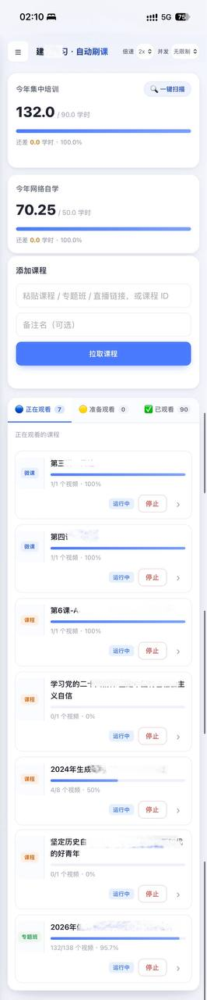
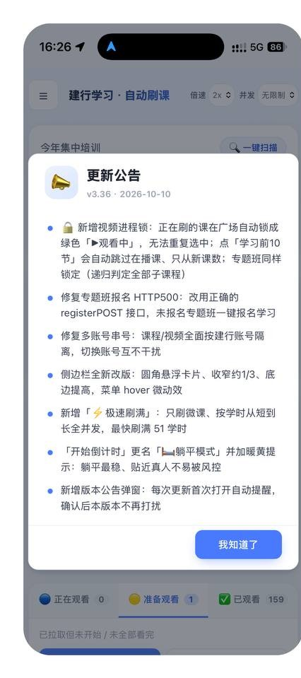
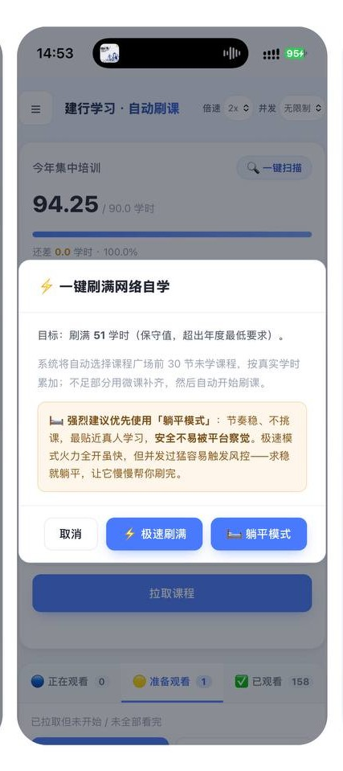

# Course Bot · 在线学习自动进度助手

[English](./README.md) · 简体中文

一个可**自部署**的容器化工具：通过模拟正常学习节奏的进度上报，自动推进在线学习平台上的
课程进度。支持**专题班 / 课程 / 微课**三类内容，带封面卡片、批量学习与真实进度核对。

> ⚠️ **仅供个人学习与技术研究使用。** 下载或使用前请务必阅读
> [免责声明](#免责声明) 与根目录 [LICENSE](./LICENSE)。

---

## ✨ 功能特性

- **三类学习内容**：专题班（自动报名）、课程、微课，统一的封面卡片界面。
- **自动进度**：模拟真人节奏的进度上报，支持 1x / 2x 两档（2x 为平台可接受的安全上限）。
- **批量学习**：一键「学习前 10 节」，无需逐个点击。
- **真实进度核对**：以平台回执为准，进度未被平台确认时不会误标完成。
- **工作台三栏**：正在学习 / 准备学习 / 已完成，自动归类。
- **自托管**：Docker Compose 一键部署，数据保存在你自己的机器上。
- **凭证安全**：账号密码仅在本次登录的内存中使用，不写入配置文件、不打印日志。

## 🖼️ 界面预览

| 工作台 | 学习广场 |
|---|---|
|  |  |

| 公告 | 自动填充 | 广场详情 |
|---|---|---|
|  |  |  |

## 🧱 技术栈

- 后端：Python · FastAPI · SQLAlchemy（async）· SQLite
- 登录：Playwright（独立 login-worker 容器）
- 前端：服务端渲染 + 原生 JS
- 部署：Docker · Docker Compose

---

## 🚀 快速开始（拉取成品镜像，推荐）

> 🔒 **需要授权——镜像为私有分发。** 成品镜像托管在**私有** GHCR 组织中，
> 无法匿名拉取，以防止滥用。
>
> **申请方式：**
> 1. 拥有一个 GitHub 账号（免费注册即可）。
> 2. 通过官方联系渠道（用户群 / 邀请邮件中的联系方式）把你的 **GitHub
>    用户名**发给作者，人工审核后开通。
> 3. 在你的机器上登录一次：
>    ```bash
>    echo 你的GitHub令牌 | docker login ghcr.io -u 你的GitHub用户名 --password-stdin
>    ```
>    令牌在 GitHub → Settings → Developer settings → Fine-grained tokens
>    创建，只需勾选只读的 **Packages: Read** 权限，无需其他权限。
>
> 如发现滥用/倒卖，作者有权随时收回拉取权限；镜像对个人学习使用始终免费。

> 本项目的**核心引擎以编译后的二进制（`.so`）随镜像分发，不提供源码、也不支持本地编译引擎**。
> 请直接拉取官方镜像运行。自行用公开仓库源码构建将**缺失引擎而无法运行**。

### 1. 环境要求

- 已安装 Docker 与 Docker Compose（支持 x86_64 / amd64）。

### 2. 准备配置

复制下面的 `docker-compose.yml`，并在同目录创建 `.env`：

```dotenv
CCB_USERNAME=你的账号
CCB_PASSWORD=你的密码
WEB_PORT=8090
```

### 3. 一键启动

```bash
docker compose up -d
```

浏览器打开 `http://localhost:8090`，在登录页输入账号密码即可。
所有数据与缓存均保存在本地 `./data` 卷中，不经过任何第三方服务器。

---

## 🔐 安全与隐私

- 账号、密码只在登录请求的内存中传递，**不落盘、不打印**，服务重启即失效。
- 所有学习数据保存在你自己部署的数据库中，不经过作者或任何第三方服务器。
- `.env` 与 `data/` 不应提交到任何代码仓库。

---

## 📦 关于源码与引擎

本项目采用「**源码可见 + 引擎闭源二进制**」的发布方式：

| 部分 | 形态 |
|---|---|
| 路由、数据模型、前端页面、调度编排、发版工具链 | 明文源码，可查看、可审计 |
| 平台接口封装、进度算法、签名等核心引擎 | 编译后的 `*.so`，仅随镜像分发 |

查看源码与引擎的边界、镜像分发方式，请见根目录 [LICENSE](./LICENSE)；
构建与脱敏工程位于 [`release/`](./release) 目录。

---

## ⚖️ 许可

本软件**不是开源软件**，采用「保留所有权利」的专有许可（见 [LICENSE](./LICENSE)）。
你可以查看源码、拉取镜像自行部署，但**不得复制、再分发、镜像转存、商用、改名发布或去除署名**。

---

## 免责声明

1. 本项目**仅用于个人学习与技术研究目的**，旨在探索 Web 自动化、容器化与前后端工程实践。
2. 是否使用、如何使用完全是**使用者个人的自主行为**，使用者应自行了解并遵守所在单位及
   平台的相关规定，并自行承担一切风险与后果。
3. 作者不对任何人使用本工具所产生的任何直接或间接后果负责，包括但不限于账号异常、
   学习记录被清除、纪律或管理处分等。
4. 请**合理、节制**使用，不干扰平台正常运行，不利用本工具从事任何违规、违法活动。
5. 本项目与任何机构、平台**无任何关联**，亦未获得其授权或背书；文中出现的名称仅用于
   指代对应的技术服务。
6. 下载、构建或开始使用，即视为已阅读、理解并同意本声明与 LICENSE 的全部内容。
